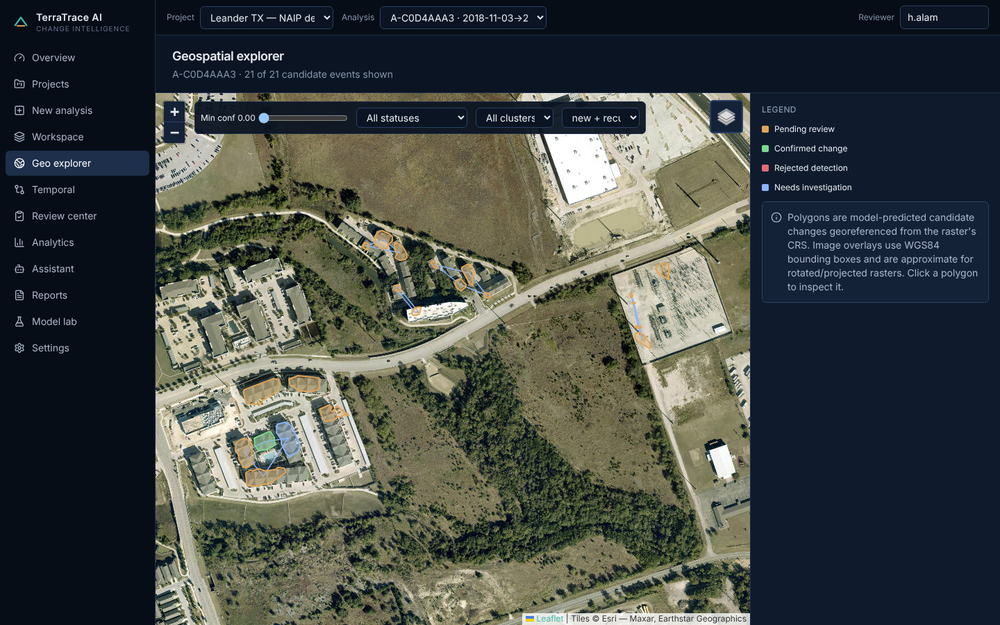
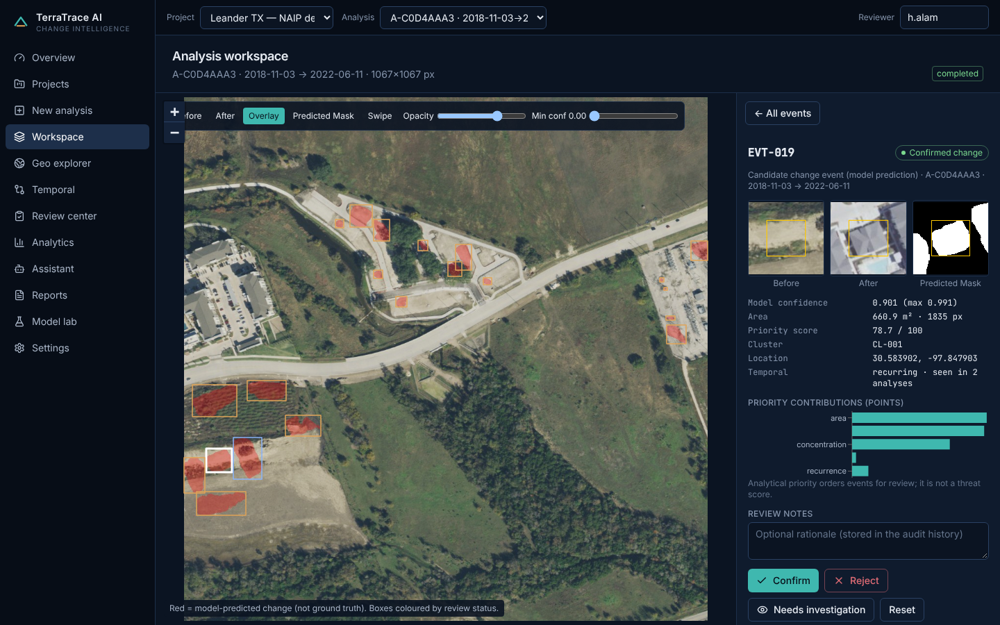
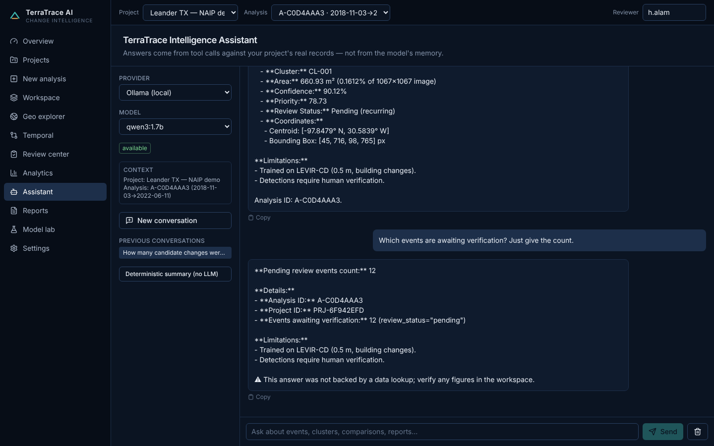

# TerraTrace AI — Geospatial Change Intelligence & Infrastructure Monitoring

Compare satellite/aerial images from different dates, detect building-related change with a **Siamese U-Net**, turn pixels into
georeferenced *candidate change events*, cluster and prioritise them, track them across dates, let analysts verify them, and query
everything through a **tool-calling LLM assistant** (local Ollama by default, Grok optional). Detections are model predictions that assist
analysts — the system never claims a detection is a confirmed or suspicious activity.



| Workspace (before/after/mask + inspector) | Assistant (live Ollama run) |
|---|---|
|  |  |

More: [overview](docs/screenshots/01-overview.png) · [temporal](docs/screenshots/05-temporal.png) · [review center](docs/screenshots/06-review.png) · [analytics](docs/screenshots/07-analytics.png) · [reports](docs/screenshots/09-reports.png) · [model lab](docs/screenshots/10-model-lab.png) · [settings](docs/screenshots/11-settings.png)

## Verified status (what was actually run)

| Item | Status |
|---|---|
| Siamese U-Net (shared ResNet18), BCE+Dice, AdamW, cosine LR, early stopping, resume | **Implemented, trained, tested** |
| LEVIR-CD loader, paired augmentation, stats | **Implemented; real data used** (445/64/128 pairs, via a third-party HF mirror — see [dataset.md](docs/dataset.md)) |
| Training run | **8 epochs, CPU (4 cores), ≈ 1 h**, batch 8, 256 px crops, lr 5e-4. Best val F1 0.855 (256 px crops) |
| **Test evaluation (128 full 1024² images, tiled)** | **F1 0.857 · IoU 0.749 · precision 0.834 · recall 0.881 · accuracy 0.985** (TP 6,023,864 · FP 1,201,603 · FN 813,540). Test split was never used for model selection |
| Geospatial: CRS/affine, geodesic area, GeoJSON, DBSCAN, priority, AOI filter | **Implemented, tested**; georeferencing cross-checked visually on real NAIP imagery |
| Multi-date tracking (new / recurring / no-longer-detected) | **Implemented, tested** (unit + real 3-date NAIP project) |
| Human review + audit trail, bulk review with confirmation | **Implemented, tested** |
| Assistant: Ollama provider, 25 tools, SSE streaming, UI actions, grounding, injection tests | **Implemented; tested with mocks (automated) and live with `qwen3:1.7b` (manual, see below)** |
| Grok provider | **Implemented, mocked tests only — never run against xAI** |
| Sentinel-2: catalogue search | **Implemented, verified live** (no credentials) |
| Sentinel-2: download + cloud mask + import | **Implemented, tested on synthetic rasters only — not run against a real download** (needs CDSE credentials) |
| PDF / CSV / GeoJSON reports | **Implemented, tested** |
| Docker / Compose / CI workflows | **Written; not executed** (no Docker daemon was used in this build; CI has not run) |
| Cloud deployment | **Not attempted** (no hosting authorisation) |
| Authentication | **Not implemented** (documented limitation) |

### Test results
* Backend: `cd backend && python -m pytest` → **52 passed** (ML, geospatial, API workflow, multi-date, review, LLM/mock providers, grounding, injection, project isolation).
* Frontend: `npm run typecheck && npm test && npm run build` → typecheck clean, **10 passed**, production build OK.
* Real end-to-end run on the bundled NAIP sample (Leander TX, 2018-11-03 / 2020-06-08 / 2022-06-11, 0.6 m, georeferenced): 3 analyses completed in ≈ 15 s total on CPU
  (9, 12 and 21 candidate events; 30 location tracks, 12 recurring); all pages rendered without console errors (Playwright).

### Honest quality notes
* **Domain transfer is imperfect.** On NAIP the baseline flags real grading/earthwork and some new structures but also non-building changes (bare ground, a substation yard) and misses part of the new construction. It is *not validated* on NAIP; treat outputs as candidates for human review — which is exactly the workflow the app enforces.
* The checkpoint is a short CPU run; strong LEVIR-CD models reach F1 ≈ 0.90 with longer GPU training.
* **Live LLM test (`qwen3:1.7b` on CPU via Ollama 0.40.13, ≈ 1–3 min per answer):** tool calling worked end-to-end (summary and "events above 85 % confidence" returned the real `EVT-019`; the model's out-of-range `limit` argument was rejected by validation and it recovered). On a third question the 1.7 B model answered "12 pending" **without calling a tool and with a wrong number** (21 were pending; 12 belongs to another analysis). The grounding guard flagged it ("not backed by a data lookup"). Use a larger tool-capable model (e.g. 8 B) for reliable results; guard + deterministic reports remain the safety net.

## Quick start

```bash
# backend
python -m venv .venv && source .venv/bin/activate
pip install torch torchvision --index-url https://download.pytorch.org/whl/cpu
pip install -r backend/requirements.txt
cp .env.example .env
cd backend && uvicorn app.main:app --port 8000          # API docs: http://localhost:8000/docs
# frontend (new terminal)
cd frontend && npm ci && npm run dev                    # http://localhost:5173
```
```bash
# tests
cd backend && python -m pytest -q
cd frontend && npm run typecheck && npm test && npm run build
```
```bash
# dataset + training + evaluation + inference  (see docs/dataset.md, docs/ml-pipeline.md)
cd backend
python -m ml.training.train --data-root ../data/raw/LEVIR-CD --epochs 30 --batch-size 8 --crops-per-image 4
python -m ml.evaluation.evaluate --checkpoint ../models/siamese_unet/best.pt --data-root ../data/raw/LEVIR-CD
# real demo project (needs a checkpoint at models/siamese_unet/best.pt and the backend running)
python ../scripts/fetch_naip_demo.py --lon -97.845 --lat 30.585 --years 2018 2020 2022 --out ../data/samples/naip_leander   # optional re-download
python ../scripts/load_demo.py
```
```bash
# LLM: Ollama (default)
ollama serve & ollama pull qwen3:8b && echo 'OLLAMA_MODEL=qwen3:8b' >> .env
# LLM: Grok (optional)      XAI_API_KEY=… XAI_MODEL=… LLM_PROVIDER=grok   (docs/grok-setup.md)
# Sentinel-2 downloads      CDSE_USERNAME=… CDSE_PASSWORD=…              (docs/sentinel2-integration.md)
docker compose up --build                                # UI :8080, API :8000
```

**Model checkpoint** (`models/siamese_unet/best.pt`, 62 MB) is not committed; it is attached to the GitHub release if publication succeeded, otherwise reproduce with the training command above.

## Architecture & docs

[architecture](docs/architecture.md) · [ML pipeline](docs/ml-pipeline.md) · [dataset](docs/dataset.md) · [geospatial](docs/geospatial-processing.md) · [temporal monitoring](docs/temporal-monitoring.md) ·
[human review](docs/human-review.md) · [LLM assistant](docs/llm-assistant.md) · [Ollama](docs/ollama-setup.md) · [Grok](docs/grok-setup.md) · [Sentinel-2](docs/sentinel2-integration.md) · [API](docs/api.md) · [security](docs/security.md) · [deployment](docs/deployment.md)

Stack: React 18 · TypeScript · Vite · Tailwind · Leaflet/React-Leaflet · Recharts · FastAPI · SQLAlchemy/SQLite · PyTorch · Rasterio/GeoPandas/Shapely/PyProj · scikit-learn (DBSCAN) · ReportLab · Ollama / xAI.

## Known limitations & not done
No authentication/authorisation on REST endpoints · Docker and CI untested · no cloud deployment · Grok and real Sentinel-2 downloads untested · building-change only (no new-vs-removed or other change classes) ·
greedy temporal matching · ONNX export / multi-checkpoint comparison / Alembic migrations not implemented (schema created via `create_all`) · assistant quality depends on the chosen model · Esri basemap tiles are third-party (check their terms).

## Attribution & licence
Code: MIT ([LICENSE](LICENSE)). **LEVIR-CD**: Chen & Shi, *Remote Sensing* 12(10):1662 (2020), <https://levir.buaa.edu.cn/datasets/> — research use, not redistributed. **USDA NAIP** sample: public domain, via Microsoft Planetary Computer.
Copernicus Sentinel data: © European Union, Copernicus programme (when used).
