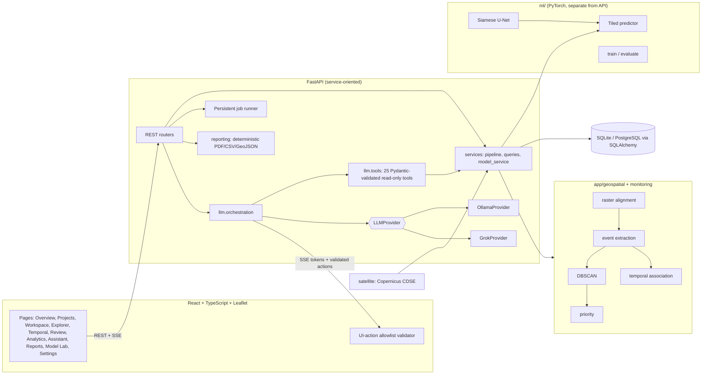

# Architecture

## Layers and boundaries

| Layer | Path | Responsibility |
|---|---|---|
| ML engine | `backend/ml/` | Architecture, dataset loader, paired preprocessing, training, evaluation, tiled inference. Imports nothing from `app/`. |
| Geospatial | `backend/app/geospatial/` | Raster inspection/alignment, pixel↔geo conversion (PyProj), connected components, DBSCAN, priority scoring |
| Monitoring | `backend/app/monitoring/` | Temporal association of events into tracks (see [temporal-monitoring.md](temporal-monitoring.md)) |
| Review | `backend/app/review/` | Status transitions + append-only audit trail |
| Reporting | `backend/app/reporting/` | Deterministic report data, PDF (ReportLab), CSV, GeoJSON |
| Satellite | `backend/app/satellite/` | Copernicus Data Space search/download/cloud-mask |
| LLM | `backend/app/llm/` | Provider abstraction, tool registry, orchestration, prompts |
| API | `backend/app/api/` | Thin routers; all heavy work is in services or the job runner |
| Frontend | `frontend/src/` | Typed API client, `AppState` (project/analysis/filter context), pages, features |

## Data model

Projects → Observations, AOIs, Analyses → Events, Clusters. `EventTrack` links events across analyses.
`EventHistory` is the append-only review audit log. `Report`, `ModelVersion`, `TrainingRun`, `Job`,
`Conversation`/`Message`/`ToolExecution` complete the schema (`backend/app/database/models.py`). Only portable SQL types
(JSON columns, no SQLite-specific features) are used, so PostgreSQL is a `DATABASE_URL` change plus `psycopg`.

## Analysis pipeline

1. Pre-flight: date order, alignment status, domain compatibility (blocks or warns; never silently resizes).
2. Load both rasters on the *before* grid (re-projecting the *after* image with Rasterio when georeferenced).
3. Phase-correlation registration check (global shift in px recorded).
4. Siamese U-Net tiled inference (256 px tiles, 32 px overlap, Hann-window blending) → probability map.
5. Threshold + morphological opening + 8-connected components → candidate events; contour polygons; geodesic areas.
6. DBSCAN clusters; temporal association (project-wide rebuild); explainable priority score.
7. Persist masks/overlays/events/clusters; job progress is stored in the DB and polled by the UI.

## Status model

Model: `not_initialized → training → trained → evaluated/available (validated on LEVIR-CD test) | failed`.
Analysis: `pending → running → completed | failed | blocked` (blocked = unsuitable input or no model, with a reason).
